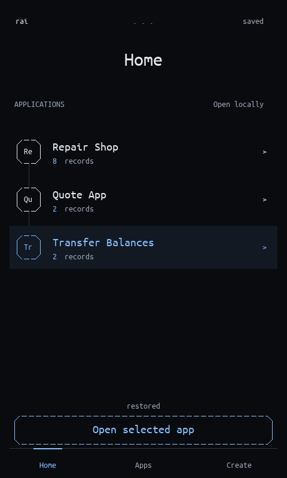

# RAI-OS

Create and evolve small tools by prompt inside an AArch64 operating-system prototype
written in Rust. Meta proposes an application; you review it; RAI-OS validates and
executes its supported operations locally.

**[Watch the three-minute demo](https://drive.google.com/file/d/18e2NPFsIktJhBC-T7ZY4ANAfQhD9PvaO/view?usp=sharing)** ·
[Try it yourself](docs/TRY_RAI_OS.md) · [App toolbox](docs/APP_TOOLBOX.md) ·
[Architecture](docs/ARCHITECTURE.md) · [Documentation index](docs/README.md)



This is the actual guest framebuffer in QEMU. A host VNC relay carries pixels and
input; the Rust guest draws the interface. The saved examples use fictional records.

## For students and curious builders

RAI-OS is also a place for university students, self-taught developers and curious
builders to explore software by making their own small tools. Describe an app,
inspect its rules, predict a result, then change a formula and see what happens
to the same records. Ordinary app operations run locally after creation.

The open source connects that experiment to systems programming: follow a Meta
proposal through Rust validation into execution and rendering in our own kernel.
Start with the [learning exercise](docs/APP_TOOLBOX.md#learn-by-changing-a-working-tool).
This is an intended use of the prototype; classroom use and learning outcomes
have not been evaluated.

## Try the saved demo — no API key

With Docker running in Linux-container mode:

```sh
git clone https://github.com/evannivw/rai-os.git
cd rai-os
docker build -t rai-os-demo -f portable/Dockerfile .
docker run --rm -it -p 127.0.0.1:5900:5900 -v rai-demo:/state rai-os-demo demo
```

Open a **VNC viewer** at `localhost:5900`; this is not a browser URL. The first build
downloads tools and dependencies. Ordinary saved-app use needs no internet connection or Meta key.
The named volume preserves your session. Ctrl-C stops it; repeat the run command to resume.

The kit contains three actual previously Meta-generated apps:

- **Transfer Balances:** move quantities between two records, preview both changes,
  and reject insufficient balance. A local page preserves the total of 17.
- **Repair Shop:** move orders through guarded workflow states and reject unpaid delivery.
- **Quote App:** edit numbers and recompute integer formulas and totals locally.

The [step-by-step guide](docs/TRY_RAI_OS.md) covers controls, VNC password setup,
local installation, recovery and troubleshooting. Native macOS and Linux containers
have been tested. A physical Windows host and physical phones have not been tested.

## Create your own supported apps

Use your own Meta Model API key; no author's credential is included. With the
[local prerequisites](docs/GETTING_STARTED.md) installed:

```sh
python3 -B scripts/demo.py configure
python3 -B scripts/demo.py check-meta
python3 -B scripts/demo.py live --output target/my-live-session
```

`configure` accepts hidden input and creates an ignored private file. `check-meta`
makes one small real request and may use API credit. The [Docker live instructions](docs/TRY_RAI_OS.md#docker-setup)
supply your private key at runtime. Never put credentials in an app prompt or Git.

Home opens apps, Apps searches them, and Create starts a new application. Inside an
app, **edit app > / F2** requests a compatible update. Meta receives the implemented
capability catalog and returns a bounded declarative definition. User review precedes
installation; ordinary execution makes no model calls. See the [capability catalog](docs/APP_CAPABILITIES.md).

## What is implemented, and where

| Component | Current role |
| --- | --- |
| Rust AArch64 kernel | Bare-metal boot, UART, memory permissions, timer and bounded EL0 task/service experiments on one QEMU CPU. |
| Guest app runtime and UI | Forms, integer formulas, guarded workflows, conditional row/whole-table actions, pages, checked transfers and software display brightness. Apps/UI share EL1 today. |
| Portable host bridge | Meta HTTPS, input relay, validated checkpoints, CSV exchange and Git history for app definitions. |
| Meta Model API | muse-spark-1.3 creates/evolves supported app definitions. Guest validation and current-state checks govern execution. |

The current app slice has **3 apps, 6 fields and 8 records per app**, 32 ASCII bytes
per cell and 128 ASCII prompt characters. It is not an arbitrary native-code compiler,
a completed microkernel, an Android replacement or a general spreadsheet editor.
App isolation, guest-native persistent storage and physical-phone drivers are future
work. [All current limits and next engineering steps](docs/APP_LIMITS.md).

## Verification and evidence

```sh
# Real QEMU use and recovery inside the built Linux image, without network:
docker run --rm --network none rai-os-demo demo-verify
```

[Final code review](docs/evidence/2026-11-04-final-review/README.md) records 114 Rust
tests, formatting/Clippy, debug/release QEMU transfer checks and rebuilt Linux demo
verification. [Recording evidence](docs/evidence/2026-11-04-submission/README.md)
retains both actual Meta requests, state assertions and the video's source revision.
[Repository-wide audit](docs/evidence/2026-11-04-repository-audit/README.md) adds
documentation consistency checks, a million-action controller stress run and
Mac/Linux startup, recovery and VNC regressions.
The video uses scripted input, edited timing and labelled synthetic narration.
No efficiency advantage over existing operating systems is claimed; the earlier
[policy comparison results](docs/SEMANTIC_COMPARISON.md) remain available.

## Project and contribution status

Jarrol Villatoro, individual participant, reported submitting RAI-OS to the Meta
Global AI Developer Hackathon on November 4, 2026. See the [project description](docs/SUBMISSION.md)
and [delivery record](docs/SUBMISSION_PACKAGE.md).

The October 13 scaffold, October 26 kernel foundations and November 3–4 app work
retain their actual dates. The supplied guide's kickoff/build-period discrepancy
remains documented. [Work log](docs/WORKLOG.md) and [historical planning record](docs/HACKATHON_PLAN.md)
preserve the sequence; the earlier [README snapshot](https://github.com/evannivw/rai-os/blob/1e88cdff509a22c5f071104f80ebef90fc887f64/README.md)
retains the full incremental overview. New documentation and commits use English.

Code is licensed under [Apache-2.0](LICENSE); fonts retain their [upstream notices](assets/fonts/NOTICE.md).
[Contribution rules](AGENTS.md) require explicit boundaries, documented unsafe
conditions, relevant tests and honest results.
