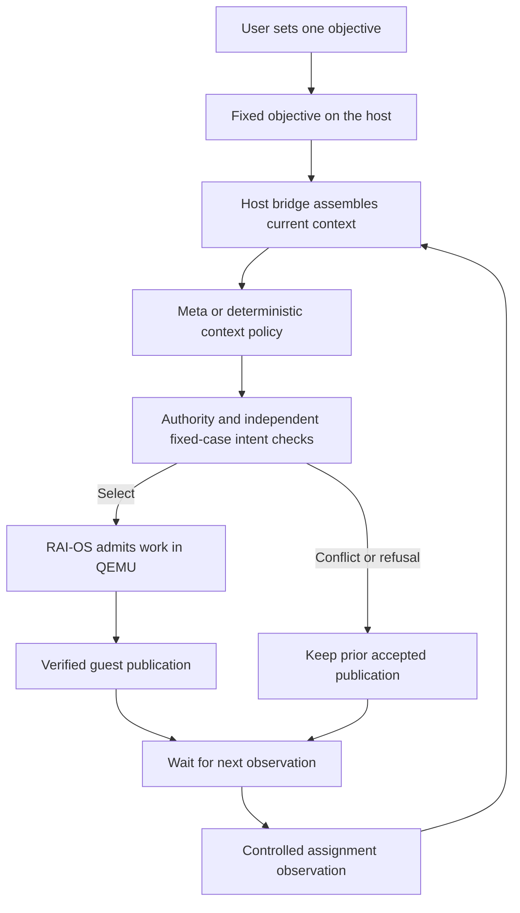

# One objective, changing context

November 2, 2026. The previous semantic session supplied three DIFFERENT written
requests from a controlled host driver. That demonstrated new interpretations in
one guest session, but did not demonstrate autonomous observation of an OS event.
This increment separates a constant objective from changing structured context.

## The cycle



The model still receives an API request (a prompt plus structured data). The user
need not type another prompt: the host program assembles it from the unchanged
objective and the delivered observation. This is three event-triggered calls, not
continuous thinking or a model running inside the kernel. The fixture driver
injects observations at ready boundaries. There is NO file watcher, real dispatch
system, sensor input, arbitrary daemon or concurrent-event mechanism yet.

Constant objective:

> Keep the Aurora handoff ready for the unit assigned by dispatch.

`request_version` now identifies the observation/evaluation, NOT a text edit to
that objective. A separate `observation.version` must match it. Natural-language
objective/interpretation/context live on the host. RAI-OS retains the resulting
required-record set, EL0 coordinator/worker state, cache and publication. The
native screen shows the last ACCEPTED guest target, not an unresolved observation.
Questions/reasons and observation text still appear in the host logs only.

## Fixed assignment policy and controlled observations

Only dispatch reports assign the unit. Maintenance reports are advisory; a greater
maintenance revision cannot override dispatch. Among dispatch reports use the
highest revision. Conflicting units at that revision, or missing dispatch evidence,
require clarification. A single assigned unit absent from the public document
catalog requires decline, not substitution. The accepted handoff includes the
matching note, project brief and checklist.

Both Meta and the deterministic baseline get the same reports, six authorized
document contents, policy, permissions and checker. The baseline selects by source
and revision, detects ties and uses the existing content resolver/dependency
closure. It does not read case IDs or expected.json. This deliberately competent
policy is sufficient for these structured rules; a win for Meta is not assumed.

| Event | Context | Expected decision |
| --- | --- | --- |
| assigned | Dispatch revision 1 assigns A; maintenance revision 99 suggests B | Publish A's handoff |
| conflict | Dispatch revision 2 reports both A and B | Clarify; no guest jobs |
| resolved | Dispatch revision 3 assigns B; older contradictory reports remain; maintenance revision 101 suggests A | Publish B's handoff |

All are fictional development observations, not physical pump control. The third
event resolves a DATA conflict; it is not a scripted user answer to the model's
question. No follow-up natural-language goal is generated. These three cases and
the exact expected memberships are authored together before live inference;
they are not independently reserved reasoning cases. This closes a missing input
boundary; it does not establish decision superiority on complex unseen situations.

## Implementation and bounds

- `context.rs`: typed observations and pure source/revision policy. Source labels
  are trusted fixture input, not authenticated digital signatures. Up to eight
  reports, 4096-byte context file, nonzero observation/report revisions, one ASCII
  uppercase unit letter, no duplicate exact reports or unknown fields/sources.
  Conflicting distinct reports remain valid input and must trigger clarification.
- `context_runner.rs`: bounded file/provider adapters. Builds the SAME objective
  for every observation, validates selection identity/capabilities and logs the
  exact current context. Context cannot carry a replacement goal or permissions.
- Provider: separate rai_context_selection schema/policy; muse-spark-1.3, minimal
  reasoning, 1024 output tokens. Old semantic prompt/settings remain unchanged.
- Shared session/checker: binds observation traces to fixture bytes and one goal;
  uses the existing strict selection stream and actual guest execution/publication.
  Trusted host intent approval is still required. The kernel does not interpret
  assignment reports or authenticate observation identity itself.

No kernel changes, unsafe code, new dependencies, corpus expansion or general
framework. Guest records remain six compiled fixtures (279 source bytes). Source
permissions/catalog are static; context events do not mutate or revoke them.
No processing of observations during inference/jobs. Stop ends retained access;
there is no disk/reboot persistence. Deterministic cache reuse is available to both
policies and cannot be credited as an AI efficiency improvement.

## Reproduce

```sh
. "$HOME/.cargo/env"
# Actual guest work with deterministic decisions, no API key/network:
python3 -B scripts/context_session.py --source rules --output target/context-rules-new
# Native QEMU screen, explicit 1500 ms presentation pauses per state:
python3 -B scripts/context_session.py --source replay --graphics --output target/context-view-new
# Clean committed source; rules then exactly three real Meta calls, no retries:
python3 -B scripts/context_session.py --source compare --output target/context-live-new
# Audit saved raw decisions/context/guest results without inference:
python3 -B scripts/context_session.py --audit-only --output target/context-live-new
```

`replay` uses explicit oracle-supplied decisions and is labeled. Use your own
ignored .env.local per META_BRIDGE.md for live Meta. Output directories must be new;
`--debug` uses the debug build. Read manifest.json, summary.json, per-event
interpret.stdout.jsonl and the guest stdout.jsonl/input stream. Compilation is
excluded from measured time; inference, checks, actual guest work and cleanup are
included. Graphic presentation pauses are excluded from the headless probe.

Freeze the corpus, policy, expected answers and source before the three-call live
probe. Retain every outcome without retries/fallback or post-result tuning. Primary
metric is correct decision plus exact membership and independently verified guest
output. Expected continuity is two publications, four total jobs, two reused
indexes and previous bytes unchanged. Report both policies even if they tie and
rules are faster. No statistical, held-out, battery or OS superiority claim.

## Verification

```sh
python3 -B scripts/verify_context_session.py --debug
python3 -B scripts/verify_context_session.py
python3 -B scripts/verify_context_session.py --graphics
```

Pure policy tests cover authority/freshness/conflict, absent units and strict input
bounds. Real-QEMU suites cover both policies/replay, eight invalid stream suffixes,
wrong-meaning fake-provider rejection with later recovery, five corrupt lifecycle
traces, changed observation evidence and seven invalid contexts rejected before
provider access. Fake transport verifies exact current observation and unchanged
objective, schema and exclusion of expected/private/future input. Final logs must
distinguish fake provider measurements from live calls.

Final rehearsal/video/submission and October 26 kickoff / October 27 build-period
eligibility remain open. Deadline November 4 at 20:00 Guatemala, internal 18:00.


## Observed result — November 2, Guatemala

The frozen live probe ran from clean source
d69c631de11e66946d575d3f5b745ff197b2ee69. Recorded start was
2026-11-03T04:47:03.792016+00:00, still November 2 in Guatemala. Exactly three
new Meta calls, no retry/fallback or post-answer tuning.

| Policy | Correct decisions | Guest publications/jobs | Whole session |
| --- | ---: | ---: | ---: |
| Rules | 3/3 | 2 / 4 | 581 ms |
| Meta | 3/3 | 2 / 4 | 11541 ms |

Meta selected A despite newer maintenance advice, clarified the dispatch conflict,
and selected B after the resolving dispatch report. It did not receive a rewritten
user objective or future observation. Both policies retained previous bytes and
reused two indexes on update; no guest work occurred for conflict. Three Meta calls
reported 2881 total tokens. Live execution was headless; the same native-display
path passed offline replay/rules tests. Compilation was excluded from timing.

[Full measured results](evidence/2026-11-02-context-session/live/summary.json) and
[manifest](evidence/2026-11-02-context-session/live/manifest.json) preserve all
outcomes. Archived traces/contexts/hashes/same-call usage re-audited successfully.

This confirms constant-goal, context-triggered integration with real guest work.
It does NOT show better decisions than the deterministic context policy, and the
model remains slower here. These rules are explicitly structured and straightforward
to implement. Further decision-quality claims need a separately designed meaningful
workload and reserved cases, rather than making this working policy worse.
