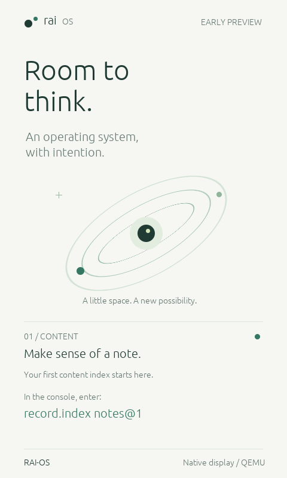
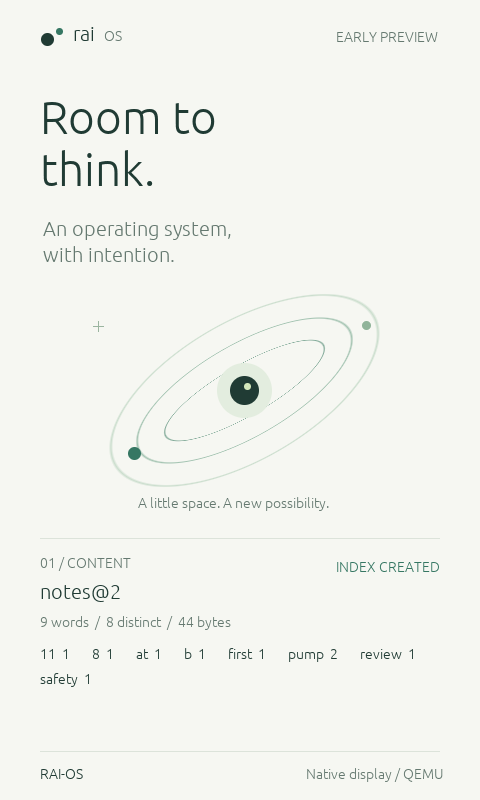

# RAI-OS native display — first screen

Implemented October 30, 2026. This is a real framebuffer drawn by RAI-OS inside
QEMU. The earlier Mac Device Lab remains a separate host application.

## Run

```sh
. "$HOME/.cargo/env"
sh scripts/desktop.sh
# Optional development build:
sh scripts/desktop.sh --debug
```

This builds the optional `guest-display` feature into `target/display`, then opens
QEMU's Cocoa window on macOS. The normal headless images/runners remain available.
The graphical window displays output; type these commands in the launching terminal:

```text
record.index notes@1
record.index notes@2
record.index empty@1
record.index restricted@1
```

Use Ctrl-C in that terminal to stop your QEMU instance. The window does not yet
accept clicks, touch or keyboard text as guest input. QEMU is not loading a Mac
application into the guest: our Rust renderer writes the actual guest display RAM.

## Design and truthful state

The visual direction is "Room to think": warm paper, dark green type, generous
space and an original fine-line constellation. The design introduces one place to
focus on a task rather than a grid of applications. It is a direction for the
future OS, not a claim of features already implemented. The constellation is a
static identity illustration, not an agent, CPU, battery or progress meter.

The lower area starts with an actionable console command. Actual successful
`record.index` execution replaces it with the exact record/revision, observed token
counts and index entries. Empty input has its own message. Denied, malformed or
failed index requests replace the previous result with an error. Unrelated
commands leave the current view unchanged. A large future result can explicitly
say "More in console" rather than silently imply everything is shown.

`INDEX CREATED` means the bounded EL0 program exited successfully. It does not mean
an external independent checker has run. Continue using [the artifact checker](RECORD_INDEX.md)
for that evidence. The first view is not connected to Meta; the existing live
bridge still coordinates counts, while this index runs as one synchronous invocation.
Stop any retained worker/coordinator before running an index.

Captured from the actual QEMU framebuffer, without compositing a host mockup:





## Architecture and memory

- `display/view.rs` renders observed state only. It never reads device registers,
  invokes a model or owns command policy. Original geometry uses integer arithmetic.
- `display/font.rs` blends committed ASCII glyph masks; no runtime font engine,
  heap, browser, GUI toolkit or new Cargo dependency. Font data and attribution are
  under [assets/fonts](../assets/fonts/NOTICE.md).
- `display/mod.rs` owns checked pixel access, fw_cfg discovery and RAM framebuffer
  setup. Construction is unsafe and exclusive; callers cannot create or clone
  a display through a public struct constructor. Every pixel access clips bounds.
- `console.rs` owns the optional display alongside the existing task/session
  objects, executes commands, then passes immutable observed results to the view.
  It does not duplicate index computation or coordinator policy.
- `mmu/tables.rs` defines the optional mappings. `display/memory.rs` is loaded once
  through the mapper and re-exported to the adapter as their shared board contract.

The current renderer runs at EL1 and shares kernel privilege. The index program
runs at EL0. This is guest-native graphics, not an isolated GUI service, compositor,
window system, Android application runtime or physical-phone display driver.
An isolated renderer can follow after a bounded drawing/syscall boundary exists.

The optional ELF has a 2 MiB NOLOAD reservation at 0x41000000..0x41200000, outside
all existing stacks and the physical-page pool. The visible 480 x 800 XRGB8888
buffer consumes 1,536,000 bytes. A dedicated final page holds persistent setup/DMA
data; remaining space is reserved. The guest links 45,701 bytes of glyph coverage
plus metrics. These are component sizes, not total OS memory usage or comparisons.
The machine still has 128 MiB configured RAM.

With `guest-display`, one existing L2 entry maps that arena as a normal non-cacheable
2 MiB block, read/write at EL1 and non-executable at both privilege levels. All
three roots share the same mapping; EL0 cannot read or write it. fw_cfg at
0x09020000 is one additional Device-nGnRnE page, also EL1-only/NX. No additional
page-table pages are allocated: twelve remain owned, and 244 pool pages remain free.
Without the feature neither region is mapped and no framebuffer bytes are reserved.

## Adapter safety and failure

Setup requires the fixed virt-9.2 board, one EL1 CPU, IRQs masked, caches off and
those mappings already active. No other owner may access fw_cfg or the arena.
The adapter bounds directory enumeration, checks device/config metadata, orders
writes with barriers and limits DMA completion polling. DMA descriptors/config
remain in reserved memory even on failure, rather than becoming dangling stack
buffers. QEMU is the trusted device; this is not a hostile-DMA isolation mechanism.

Absent ramfb, malformed configuration or DMA write rejection leaves a working
UART console with an explicit diagnostic. No silent screenshot-success fallback
is supplied. The default headless path keeps its original boot/protocol behavior.

Pixels are repainted only at boot and on index outcomes. There is no guest animation
loop. QEMU may refresh its window independently. The existing UART loop still polls
and caches remain disabled, so this design does not establish low idle CPU, power
savings or superior performance. Graphics rendering occurs after the index's EL0
budget is stopped; graphical request latency includes drawing before the UART reply.

## Verification

```sh
python3 scripts/verify_display.py
python3 scripts/verify_display.py --release
# Opens and closes a real macOS QEMU window during the test:
python3 scripts/verify_display.py --release --cocoa
```

Each normal suite checks five pure table-construction cases, malformed/overflowing
index-summary handling, and eight QEMU boots:
normal display, missing device, invalid configuration, rejected DMA setup, and four
intentional EL0 access failures. QMP screendump captures the actual framebuffer;
standard-library Python validates dimensions/pixels, state-dependent changes,
repeatable renders, unchanged identity area, stale-result replacement and recovery.
All six record indexes are independently checked against their fixture bytes.

EL0 framebuffer read/write/execute probes fault at level 2; fw_cfg access faults
at level 3. Tests inspect the architectural syndrome/address, verify unchanged
pixels and execute an index afterward. Existing headless tests remain necessary;
the Cocoa smoke test separately verifies the visible host display backend.
Generated screenshots and raw transcripts are stored under `target/verification/`.

## Interface references

- [QEMU Arm virt](https://www.qemu.org/docs/master/system/arm/virt.html)
- [fw_cfg interface](https://www.qemu.org/docs/master/specs/fw_cfg.html)
- [ramfb interface implementation](https://github.com/qemu/qemu/blob/v11.1.0/hw/display/ramfb.c)

The adapter is an original implementation of those interfaces. ramfb is an initial
software display for the fixed TCG demo; no accelerated GPU performance is claimed.

## Retained coordinator views

The same native screen now renders `coord.start index`, observe, propose, status
and result outcomes. A new goal displays WAITING FOR PLAN and its exact proposal
command. Successful jobs display INDEX CREATED; cache reuse displays INDEX REUSED
with the original revision's content. Duplicate observations/status preserve the
reuse label. Errors replace the visible result; successful status restores the
retained state. Stop returns to the standalone ready screen. The coordinator
and worker remain at EL0; the renderer still runs at EL1. See
[RETAINED_INDEX.md](RETAINED_INDEX.md).

## Meta-driven index session

`sh scripts/meta.sh --graphics --guest-index fixtures/guest_index/v1/observations.json`
now opens this same native screen while the host transports Meta proposals and
scripted observations. The kernel renderer is unchanged; only actual coord.*
outcomes drive its states. Use `--guest-index-replay` and the replay file for an
offline walkthrough. The owned window closes at session cleanup. See
[META_INDEX_BRIDGE.md](META_INDEX_BRIDGE.md).

## Required-set progress

An active `coord.goal` now selects a native set view, showing the validated goal
generation, ready/required entry counts, total worker jobs and each exact revision
as INDEXED or WAITING. SET COMPLETE means all required cache entries exist, not
that an external verifier or the entire review-pack contract has passed. Changing
a revision immediately changes the view; failures replace it and status can
restore the retained state. The original visual identity and framebuffer path
are unchanged. Run `sh scripts/bundle.sh --graphics`; see [INDEX_SETS.md](INDEX_SETS.md).

## October 31: publication states

The [native publication view](PUBLICATION_DISPLAY.md) now shows actual current,
updating, verifying and blocked states, together with earlier-result availability.
Run sh scripts/publication.sh for a checked, stepwise native walkthrough. Active
set goals use this view; standalone index screens retain their original behavior.
No model, timing or battery claim follows from these graphics.
