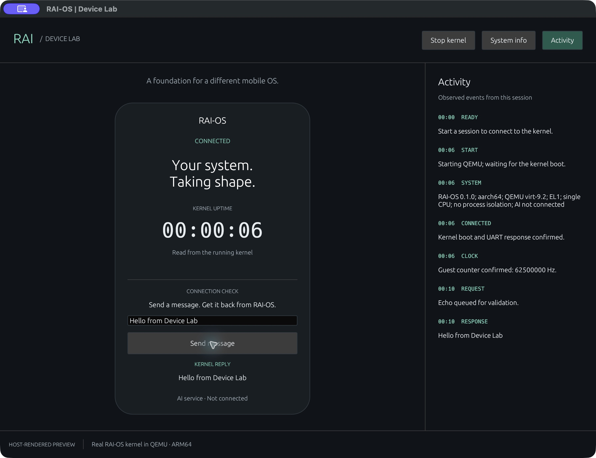

# Device Lab: graphical host panel

Implemented October 26, 2026. A native Rust window controls the real RAI-OS
AArch64 kernel in QEMU. The portrait card is a host-rendered mobile presentation,
not a guest framebuffer, Android emulator, or supported physical phone.



Captured October 26, 2026 during a real boot and echo round trip.

## Run

From the repository root:

```sh
. "$HOME/.cargo/env"
sh scripts/panel.sh
```

The launcher builds the existing guest kernel, explicitly selects the Rust host
target for the panel, and opens the window. First build downloads GUI dependencies
from crates.io. Rust 1.90.0, Cargo, QEMU, Python 3, and the macOS developer tools
are required for the tested path. Only macOS ARM64 has been verified.

On macOS the script also builds and ad-hoc signs a local application bundle at
`target/RAI-OS Device Lab.app`. It can subsequently be opened from Finder. Keep
that generated bundle in the repository's target directory: it locates the
repository from that layout and needs scripts/qemu.sh plus the built kernel.
This is a development bundle, not a standalone/notarized distribution. No system
security settings are changed. Rebuild after moving the repository or updating
code; generated applications and binaries are not committed.

The non-macOS launcher uses the native binary directly. Linux/Windows UI behavior,
platform graphics dependencies, and setup instructions remain unverified.

## Controls and truthful state

- **Start kernel**: launches QEMU, waits for the actual boot and console banners,
  and obtains an info response before displaying CONNECTED.
- **Stop kernel**: terminates and reaps the QEMU child before displaying OFFLINE.
  Start is available again for a fresh boot. No saved guest state is restored.
- **Kernel uptime**: requests the guest clock approximately once per second;
  displays hours/minutes/seconds from the received millisecond value. The UI
  never advances it with a local animation. If a sample is late, the caption
  indicates that it is awaiting the kernel; transport errors clear live readings.
- **System info**: sends a fresh info request and reveals its response in Activity.
- **Send message**: performs an actual echo round trip. Printable ASCII only;
  invalid input is rejected before UART transmission. No model generates replies.
- **Activity**: toggles the recent event log. It retains at most 80 entries in
  memory and uses elapsed host time since the panel opened. These log timestamps
  are separate from guest uptime and are not benchmark measurements.

Closing the window drops the session worker and cleans up its QEMU child. A
pending UART wait can delay cleanup by up to its 10-second timeout. Stop during
startup can wait for both the boot and initial info phases (each bounded by 10 s).
The window itself remains responsive while those phases execute on the worker.
A hung kernel is reported as a failure, not a fabricated successful session.

The UI has no battery, GPU, memory-utilization, agent, or efficiency gauges.
AI is explicitly shown as not connected. Old log entries are history; they are
not current connection state. There is no network listener or web server.

## Architecture and dependencies

- `host/panel/src/app.rs`: presentation, user actions, and rendering observed events.
- `host/panel/src/worker.rs`: session coordinator on a background thread. Owns the
  QEMU connection, serializes requests, validates clock payloads, and sends events.
  Command/event queues are bounded; there is one outstanding UART request.
- `host/shared/model.rs`: command parsing, encoding, and response validation.
- `host/shared/qemu.rs`: existing process/UART adapter, shared with the terminal
  console. Ownership cleanup stops and reaps QEMU.
- `host/panel/src/main.rs`: native window composition and local-bundle path setup.
- `src/`: the existing no_std/no_main kernel. No GUI dependencies were added here.

The two shared files moved from examples/control_console without changing their
protocol behavior. The terminal console still uses its own presentation module.
The panel has a separate Cargo manifest and lockfile, with
[eframe 0.32.3 / egui](https://docs.rs/eframe/0.32.3/eframe/) pinned for the native
window and rendering. Its dependency tree belongs to the host application, not
the kernel. Keep both lockfiles for reproducible dependency selection.

We wrote the small RAI-OS kernel; QEMU supplies virtual hardware. The GUI toolkit
supplies host windowing/rendering. Neither is an Android/Linux kernel underneath
RAI-OS. A custom kernel is useful for this learning/research direction, but does
not by itself establish better efficiency, security, or phone compatibility.

## Verify

From the repository root:

```sh
cargo fmt --check
cargo fmt --manifest-path host/panel/Cargo.toml --check
cargo clippy --locked --manifest-path host/panel/Cargo.toml \
  --target aarch64-apple-darwin --target-dir target/host-panel -- -D warnings
python3 scripts/verify_panel.py
python3 scripts/verify_console.py
```

The panel verification script discovers the compiler host triple, builds the test
binary, and runs it from the repository root. Five tests include two live-QEMU
checks: boot/clock progress, rejected input, echo recovery, Stop, restart, window
worker cleanup, and a missing kernel image that must never report connected.
Three tests check protocol/clock validation without QEMU. Their combined output
is retained in target/verification/panel-worker.log. Running cargo test directly
runs only the three ordinary unit tests; the two environment-dependent tests are
ignored unless enabled by the verification script.

Also build an optimized host panel when changing executable code:

```sh
cargo build --locked --manifest-path host/panel/Cargo.toml \
  --target aarch64-apple-darwin --target-dir target/host-panel --release
python3 scripts/package_panel_macos.py --release
```

Use the actual host triple instead of the example when building on another host.
These tests exercise the worker, not GUI clicks. Native-window review separately
checks visible boot/uptime, message replies, System info, Activity visibility,
Stop/restart, and closing a running session. No physical phone has been tested.

## Next increment

Use this panel to expose a small amount of real guest task state, then introduce
bounded jobs and their validation. A native guest display/input driver is a
separate future milestone. Preserve the mobile direction without presenting the
host-rendered card as a completed phone operating system.
