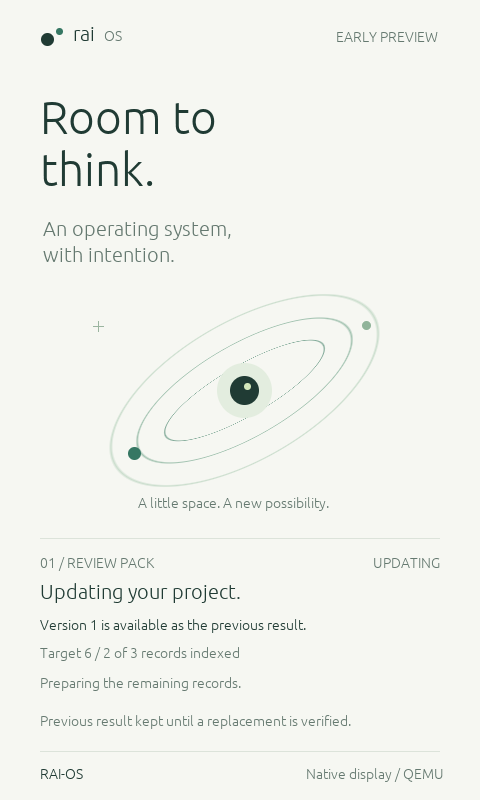
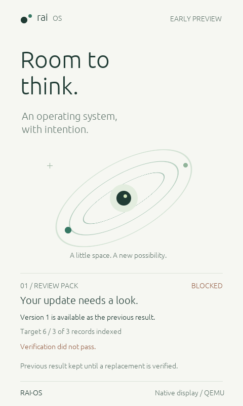
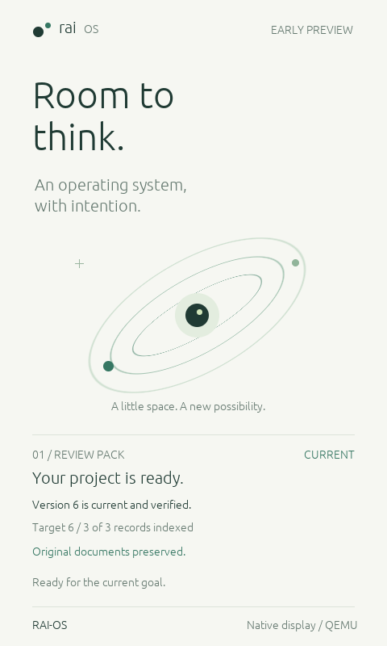

# Native publication states

Implemented October 31, 2026. The existing RAI-OS framebuffer now renders the
[publication lifecycle](PUBLICATION.md) from real guest state. It distinguishes
the active target from a readable earlier result; indexing alone never displays
CURRENT. This is guest output in QEMU, not the Mac Device Lab or a mockup.

## Watch the walkthrough

From the checkout root:

```sh
. "$HOME/.cargo/env"
sh scripts/publication.sh
```

The script builds the release kernel and Rust host walkthrough, opens QEMU's
native window and pauses at each state. Press Enter in the launching terminal
to advance. After the final pause it stops the session and closes its guest.
The screen itself is not touch/click enabled. Ctrl-C ends the walkthrough.

```sh
sh scripts/publication.sh --auto      # Same window, timed presentation pauses
sh scripts/publication.sh --headless  # Same operations/checks, no window or pauses
```

The terminal explicitly labels scripted events and the deliberately injected
verification failure. No Meta API key or model call is used. The host supplies
requirements, transports commands and checks artifacts; the guest builds and
retains actual indexes and admits publication. Pauses are for presentation, not
measured inference or execution time. This is not a performance comparison.

Each run creates a new target/publication-demo-* directory. initial.json and
updated.json are exact guest candidates that passed the independent checker
before acknowledgment. injected-invalid.json deliberately contains an invalid
host checker input, not a corrupted source file. The walkthrough checks that its
rejection preserves the previous guest publication, rejects an obsolete ticket,
then retries correctly. It finishes with four worker jobs: three initially and
one for notes@1 -> notes@2; the other two indexes were reused.

## What the screen means

| Label | Observed state |
| --- | --- |
| NOT STARTED | No target or publication, including after explicit stop. |
| PREPARING | First target active; no previous verified result. Complete indexes may still be awaiting preparation/verification. |
| UPDATING | A different target is active and the previous publication is readable. |
| VERIFYING | A complete candidate is awaiting the trusted validation acknowledgment. |
| CURRENT | The committed publication matches the active goal. |
| BLOCKED | A validation rejection or worker/session failure blocked this update. Earlier output, if present, is identified separately. |

The text shows publication availability, target generation and current indexing
progress. The displayed version is the publication's goal generation, not a file
revision or a count of publications; gaps are expected from the shared issue
counter. Failure after guest cleanup shows preparation unavailable rather than
inventing progress. No energy, time-saving or agent telemetry is fabricated.

Rejected/malformed requests show a notice without replacing the actual lifecycle
state. A following status/read clears that transient notice while preserving
state and exact output. Historical output is explicitly previous, never current.
The display trusts the host validation acknowledgment exactly as the lifecycle
does; it cannot prove a malicious host actually ran a checker.

Actual QEMU captures (release; matched debug byte-for-byte):







## Architecture and verification

publication::Status has read-only presentation accessors. Console executes the
operation, then supplies the observed status, optional bundle progress and any
request notice to the existing renderer. The renderer cannot change publication
state, generate a successful verdict or call a model. Active required sets use
this view automatically, including legacy bundle scripts: a structurally complete
export without acknowledgment remains PREPARING/UPDATING, not CURRENT. Standalone
per-record views and the existing visual identity are preserved.

The first debug implementation reproduced timer_busy at coordinator startup.
Keeping all rendering branches in Console::execute increased its frame to 5296
bytes. Moving presentation into render_result reduced that execution frame to
656 bytes (render helper: 3088), measured from the compiled AArch64 prologues.
The failing sequence then passed. No stack enlargement or timer-check relaxation
was used. This resolves the reproduced path; it is not a whole-kernel stack bound.

```sh
python3 scripts/verify_publication_display.py
python3 scripts/verify_publication_display.py --release
```

Both profiles passed normal and deliberately truncated-worker native scenarios.
Tests cover unverified completeness, initial/current/historical states, actual
retained bytes, verification rejection/retry, stale and malformed notices, worker
failure, identical-content new goals and stop. Thirty-five corresponding captures
were byte-identical between profiles. Representative PNGs and four raw UART traces
are retained in evidence/2026-10-31-publication-display; original evidence is intact.

Existing bundle, publication and base-display suites also passed in both profiles,
including display mapping protections. Formatting, default/debug and display
kernel Clippy checks passed, as did the new host example Clippy and its six
protocol tests in debug/release. The public walkthrough completed headless and
with the native window in automatic mode. Interactive pauses are a host stdin
convenience, not guest input support. No live Meta inference was performed.

Next: provider rejection diagnostics and bounded batch proposals. Semantic
planning, a measured AI advantage, the final video and submission remain pending.
