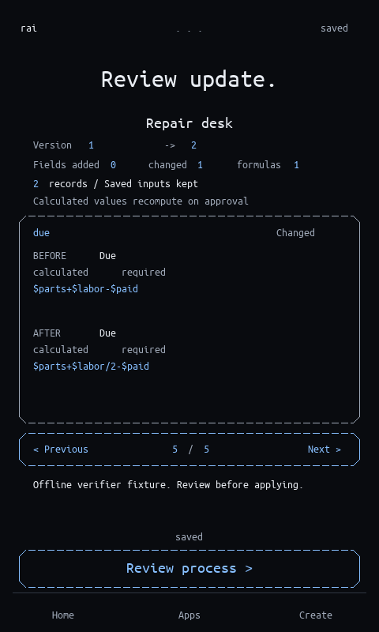

# Visible application updates — November 4, 2026

Base commit: `73bce02d2f2ddb80c561623718331ccb81bc25db`, plus this increment.
This improves the existing guest app review; it does not add new app capabilities
or change the submitted video's original source revision.

## What changed

Compatible updates show the installed and proposed versions, field-level counts
and a BEFORE/AFTER card for each field. Cards include labels, types, required
flags, defaults and complete formulas. The first changed field is selected;
keyboard arrows/Tab and the native Previous/Next controls cycle through fields.

The usual approval sequence remains intact. Buttons now name the next review
stage or final installation/update accurately. Saved inputs remain after a
compatible update; derived results are recomputed. Cancellation, late responses,
invalid migrations and stale revisions cannot silently install a proposal.
The counts describe fields, not every possible behavior/page/filter difference.
This is an inspectable declaration comparison, not proof of the user's intent.



This capture uses an explicit offline verifier fixture, not a fresh Meta response.
The actual Meta creation/evolution recording remains in the
[original submission evidence](../2026-11-04-submission/README.md).

## Verified behavior

- 33 host controller/domain tests, including four new controller regressions;
  114 host bridge tests. These suites overlap in domain coverage and are not
  presented as 147 unique tests.
- One million deterministic controller actions without panic. This is stress
  coverage, not a proof of semantic correctness or security.
- Rust formatting and kernel/host Clippy with warnings denied.
- Real QEMU in debug and release: exact review/cancel/checkpoint preservation,
  keyboard/pointer paging, late/stale/invalid rejection, formula migration,
  appended defaults, no-op, page-only and brightness updates, then fresh recovery.
- All 17 framebuffer captures match byte-for-byte across final debug and release.
  The maximum 64-byte formula's final character is checked in the actual raster.
- Existing saved-demo and Git definition-restore regressions passed on macOS.
- Rebuilt Linux image passed the new update verifier and saved-demo recovery
  with networking disabled. Image/source provenance is retained below.

The fixture's two pending amounts change from 1000/1000 to 0/500 when a compatible
formula halves labor cost. All editable inputs remain identical. The unchanged
zero-due delivery guard permits the first order and rejects the second. These
are deterministic correctness checks with fictional data, not a model-quality,
customer-impact or performance benchmark. No real Meta request or private-key
read occurred in this increment.

## Memory and failed attempts

Initial development compilation worked, but release linking exceeded the existing
MMU RAM window. Failed attempts are retained in the numbered build logs. Shared
field comparison and non-inlined drawing helpers removed duplicate code; no
linker boundary, page-pool size, memory map or compiler profile was changed.

Both final profiles end the page pool at `0x40200000`, exactly the configured
boundary. Remaining mapped headroom is **0 bytes**; the linker still enforces it.
This is not exhausted physical RAM, but future code growth requires an explicit
memory-layout decision. `layout.json` binds the verified binaries to their hashes.

The external Homebrew llvm-nm could not run because its z3 library was missing;
measurements used the existing repository ELF parser and linker map instead.

## Reproduce

```sh
python3 -B scripts/verify_app_update_review.py --debug --output target/update-review-debug-new
python3 -B scripts/verify_app_update_review.py --output target/update-review-release-new
rustc --edition 2024 --test scripts/check_update_review.rs -o target/update-review-tests
target/update-review-tests
```

Use fresh output directories. The Python verifier supplies disclosed definitions
and never invokes the model. Actual app updates still require live mode and the
user's own key, or a deliberately supplied verifier proposal. See
[the controls](../../MICROAPPS.md#reviewing-a-compatible-update).
